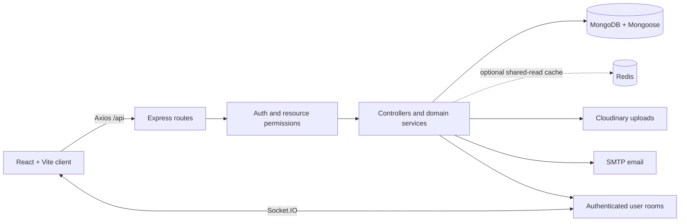

<div align="center">

# CampusOS

### A connected workspace for campus life

Bring classes, clubs, events, discussions, notices, and placements into one student portal.

[](https://react.dev/) [](https://expressjs.com/) [](https://mongoosejs.com/) [](https://socket.io/) [](https://tailwindcss.com/)

**[Explore features](#what-campusos-does) · [Run locally](#run-locally) · [Architecture](#architecture) · [Project status](#project-status)**

</div>

---

CampusOS (also named EventSphere in package names) is a full-stack college portal. Students can see what needs attention today, join campus communities, follow their academic schedule, discuss questions, and track placement applications. Staff and resource administrators manage those workflows in the same system.

The repository contains two independent applications: a React client in [`frontend/`](frontend/) and an Express API in [`backend/`](backend/). Each has its own dependencies and commands.

## What CampusOS does

| Workspace | Available capabilities |
| --- | --- |
| **Home** | A personalized dashboard combines today's classes, registered events, placement rounds, upcoming deadlines, eligible drives, and relevant notices. Global search spans clubs, events, drives, and discussions. |
| **Academics** | Classrooms have curricula, a weekly period timetable, semester-specific deadlines, and classroom notices. Class representatives maintain their own classroom; administrators manage classrooms and curricula. |
| **Community** | Students discover and follow clubs, mute club notifications, register for events, read announcements, and participate in discussions with votes, bookmarks, comments, replies, and accepted answers. |
| **Career** | Students browse drives with eligibility checks, apply once per drive, and follow application and round progress. Placement coordinators manage rounds, preview and confirm CSV shortlists, and finish or cancel drives. |
| **Administration** | Administrators manage clubs, classrooms, curricula, notices, and the student roster. The roster supplies authoritative academic data for account activation and placement eligibility. |

### Recent improvements

- **Safer accounts:** roster-based student activation, email verification, password reset, per-device sessions, rotating refresh tokens, and auth rate limits.
- **Stronger write paths:** transaction-backed roster and club-follow updates, idempotent follow and registration actions, and checks against duplicate drive applications and shortlist processing.
- **Faster shared reads:** optional Redis caching for club lists, upcoming events, search, shared classroom data, the default drive catalogue, and classroom notices. Writes invalidate the affected entries; time-sensitive and user-specific dashboard data is calculated per request.
- **Better discussion browsing:** paginated discussion lists and cursor-paginated comments and replies, with retry states in the client.
- **Live updates:** MongoDB-backed notifications are delivered to authenticated Socket.IO user rooms; unread state remains available after reconnecting.

## Architecture



The API uses cookie-based JWT authentication. Access and refresh tokens are held in `httpOnly` cookies; refresh sessions are stored per device with hashed refresh tokens. Backend routes enforce both global roles and resource-specific permissions. The frontend uses shared Axios wrappers, React Context for auth and notifications, and page-local state for most domain data.

| Layer | Main tools |
| --- | --- |
| Client | React 18, React Router 6, Vite 5, Tailwind CSS 4, Axios, Socket.IO client |
| API | Node.js, Express 4, Mongoose 7, Socket.IO, JWT, Multer, Cloudinary, Nodemailer |
| Data | MongoDB; Redis is optional and used only as a cache |
| Verification | Vitest and Supertest API tests with an in-memory MongoDB replica set |

### Redis cache TTLs and operational notes

TTL constants remain next to their read paths. All values below are seconds from the cache write; MongoDB remains authoritative.

| Cache | Key | TTL | Reason |
| --- | --- | ---: | --- |
| Active clubs | `cache:clubs:active` | 24 h | Club details change rarely; create, update, and follow writes invalidate it. |
| Popular clubs | `cache:clubs:popular:active` | 1 h | Follower ranking changes more often; club/follow writes invalidate it. |
| Upcoming events | `cache:events:upcoming` | 15 min | The set changes as events end; create/update writes invalidate it. Cancelled events are excluded when the DB query refills the key. |
| Global search | `cache:search:v2:<normalizedQuery>` | 60 s | Many query variants; source writes do not invalidate individual search keys. |
| Academic classroom | `cache:classroom:<id>:academic` | 1 h | Shared academic data changes infrequently; period, semester, classroom, and curriculum edits invalidate it. |
| Classroom notices | `cache:notices:classroom:<id>` | Up to 5 min | Writes invalidate it; TTL is shortened to the earliest visible notice expiry. |
| Default drive catalogue | `cache:drives:catalog:default` | 60 s | Candidate set is shared; application state, eligibility, and final page documents are read per request. |

The cache helper counts hits, misses, Redis-not-ready bypasses, and GET/SET/DEL/JSON errors by key family. It reports cumulative per-process counters only after activity, every minute in development and every five minutes in production; it logs no keys, search text, payloads, or Redis URL. A malformed JSON value is deleted by its exact key and treated as a miss. Maintenance scripts bound their optional Redis connection wait to eight seconds and continue when cleanup cannot run.

Cache-aside has bounded stale windows: a Redis outage can skip invalidation, and a read racing a DB write can repopulate an older value after deletion. TTL is the eventual freshness bound; there is no stampede lock or cross-database atomicity. An out-of-band cancellation may remain in a previously cached upcoming-events value until its 15-minute TTL ends. A missed drive invalidation can briefly leave catalogue membership or pagination totals stale, while personal application/eligibility values and displayed drive documents are still read live.

### Repository map

```text
backend/
  app.js             Express middleware and mounted API routes
  server.js          MongoDB, optional Redis, HTTP, and Socket.IO startup
  config/            Environment validation and service connections
  routes/            Route definitions and middleware chains
  controllers/       Request handling and domain logic
  services/          Auth, eligibility, dashboard, shortlist, notification logic
  models/            Mongoose schemas and indexes
  middleware/        Auth, permissions, rate limits, uploads, and errors
  scripts/           One-off data migrations and reconciliation
  tests/             API integration tests
frontend/
  src/App.jsx        Client routes and access guards
  src/api/           Resource wrappers around the shared Axios client
  src/context/       Authentication and notification providers
  src/pages/         Dashboard and domain workspaces
  src/components/    Layouts, forms, and reusable UI
```

## Run locally

### Prerequisites

- **Node.js 20.19+ with npm 10+**, or Node.js 22.13+. The current backend test and development dependencies require these versions.
- **MongoDB replica set** (local or Atlas). Several account and relationship writes use MongoDB transactions, so a standalone MongoDB server is insufficient for the full app.
- **Cloudinary** credentials to use media uploads. **SMTP** is optional in development; without it, activation and reset links are printed to the backend console.
- **Redis** is optional. The app continues to read from MongoDB when Redis is unset or unavailable.

```bash
git clone https://github.com/aravindpulkam3/CampusOS.git
cd CampusOS
```

### 1. Start the API

From the repository root:

```bash
cd backend
npm install
```

Create `backend/.env` with your own values:

```dotenv
NODE_ENV=development
MONGO_URI=<your-mongodb-replica-set-uri>
CLIENT_URL=http://localhost:5173
JWT_ACCESS_SECRET=<random-secret-at-least-32-characters>
JWT_REFRESH_SECRET=<different-random-secret-at-least-32-characters>
PORT=5000
TZ=Asia/Kolkata

# Optional in development
# REDIS_URL=redis://localhost:6379
# CLOUDINARY_CLOUD_NAME=
# CLOUDINARY_API_KEY=
# CLOUDINARY_API_SECRET=
# SMTP_HOST=
# SMTP_PORT=
# SMTP_USER=
# SMTP_PASS=
# MAIL_FROM=
```

Generate **two different** secrets, for example with `node -e "console.log(require('crypto').randomBytes(48).toString('base64url'))"` run twice. The server validates configuration at startup and reports missing or invalid settings.

```bash
npm run dev
```

The API listens on port `5000` by default. `npm start` runs it without nodemon.

### 2. Start the client

In a second terminal, from the repository root:

```bash
cd frontend
npm install
```

For local development, create `frontend/.env` with:

```dotenv
VITE_API_URL=/api
```

```bash
npm run dev
```

Open the URL printed by Vite, normally `http://localhost:5173`. Vite proxies `/api` and `/socket.io` to port `5000`. If `VITE_API_URL` is omitted, the Axios client defaults to `http://localhost:5000/api` and makes cross-origin requests using the configured `CLIENT_URL`.

**Account setup:** students can activate accounts only after a superadmin imports their roster entries through **Admin → Roster**. Staff accounts are administrator-provisioned; this repository does not include a general-purpose superadmin bootstrap command. The old `backend/seed.js` targets announcements for a specific event and is not an account or database bootstrap.

## Configuration

The backend's source of truth is [`backend/config/env.js`](backend/config/env.js). Its core settings are:

| Variable | Purpose |
| --- | --- |
| `NODE_ENV` | Required: `development`, `production`, or `test`. Production enables secure cookies. |
| `MONGO_URI` | Required MongoDB connection string. Use a replica set for transactional operations. |
| `CLIENT_URL` | Required frontend origin for HTTP and Socket.IO CORS and email links. HTTPS is required in production. |
| `JWT_ACCESS_SECRET`, `JWT_REFRESH_SECRET` | Required, distinct secrets of at least 32 characters each. |
| `JWT_ACCESS_EXPIRY`, `JWT_REFRESH_EXPIRY` | Optional JWT lifetimes; defaults are `15m` and `7d`. |
| `PORT`, `HOST` | API port defaults to `5000`; production requires a loopback `HOST`. |
| `CLOUDINARY_CLOUD_NAME`, `CLOUDINARY_API_KEY`, `CLOUDINARY_API_SECRET` | Set all three for uploads; required in production. |
| `SMTP_HOST`, `SMTP_PORT`, `SMTP_USER`, `SMTP_PASS`, `MAIL_FROM` | Set all five for outbound mail; required in production. Development can log links instead. |
| `REDIS_URL` | Optional cache connection. |
| `TRUST_PROXY` | Proxy trust for correct client IPs and rate limits; required in production. Use `loopback` with local Nginx. |
| `RATE_LIMIT_*` | Optional auth rate-limit tuning; see [`rateLimitMiddleware.js`](backend/middleware/rateLimitMiddleware.js). |
| `TZ` | Set to `Asia/Kolkata` if campus day boundaries should use IST. Dashboard date logic uses server-local time. |

`VITE_API_URL` is the only frontend environment variable used here. For a production build served from the same origin as the API, set it to `/api` **before** running `npm run build`. The reverse proxy must forward both `/api` and `/socket.io` to the backend.

## Access model

| Permission | Scope |
| --- | --- |
| `student` | Dashboard, classroom, community, and placement participation. |
| `placementCoordinator` | Drive and recruitment management, plus authorized academic corrections in the roster. |
| `superadmin` | Platform administration, including clubs, classrooms, curricula, roster, and notices. |
| Classroom `classRepresentative` | Timetable, deadlines, classroom notices, and semester progression for that classroom. |
| Club `clubAdmins` | Club profile, events, announcements, and notices for that club. |
| Event `eventOrganizers` | Event management, announcements, and notices for that event. |

The first three are global user roles. The remaining permissions come from relationships to a specific resource; the API checks them on mutations.

## API overview

All routes are under `/api`. Standard successful responses use `{ success, message, data }`; the upload endpoint also returns its uploaded `url` and `publicId` directly.

| Base path | Responsibility |
| --- | --- |
| `/api/auth` | Activation, sign-in, refresh, sign-out, password reset, profile |
| `/api/dashboard` | Personalized dashboard and global search |
| `/api/classroom`, `/api/admin/classroom`, `/api/curriculum` | Classrooms, timetable, deadlines, semester progression, curricula |
| `/api/admin/roster` | Roster import and academic updates |
| `/api/clubs`, `/api/events`, `/api/announcements` | Community and event workflows |
| `/api/discussions` | Paged discussions, comments, replies, votes, bookmarks |
| `/api/notices`, `/api/notifications` | Scoped notices and persisted notifications |
| `/api/drives`, `/api/applications` | Placement drives, rounds, shortlisting, applications |
| `/api/v1/upload` | Authenticated Cloudinary upload (`file` field) |

## Verification

```bash
# From backend/: integration tests use an in-memory MongoDB replica set
npm test

# From frontend/: production client build
npm run build
```

The test runner may download a MongoDB binary on its first run. There is currently no frontend test or lint script.

## Deployment and existing data

For a single-VM production deployment, serve the built client over HTTPS and reverse-proxy `/api` and `/socket.io` to Node. Set `HOST=127.0.0.1`, `TRUST_PROXY=loopback`, `CLIENT_URL` to the public HTTPS frontend origin, and `VITE_API_URL=/api` at build time. The backend validates these production settings. Auth cookies use `SameSite=Strict`, so the client and API should share a site. Keep Node behind the proxy; rate-limit counters are process-local, so run one API process unless you add a shared rate-limit store.

The API sets security headers for API responses. The server hosting the SPA must also set headers for `index.html` and static assets. Roll out a Content Security Policy in report-only mode first and account for Socket.IO and hosted media.

If upgrading an older database, review the scripts before running them against a backup:

```bash
# Run from backend/; import the student roster before the auth migration
node scripts/migratePhase1Auth.js --dry-run
node scripts/migratePhase1Auth.js

# Reconcile counts created by the older club-follow implementation
node scripts/reconcileFollowerCounts.js --dry-run
node scripts/reconcileFollowerCounts.js

# Only for databases using the old drive selectionProcess format
node scripts/migrateDriveRounds.js
```

`migratePhase1Auth.js` removes legacy refresh tokens, links matching students to roster entries, and requires those students to activate through email. It signs users out once. `reconcileFollowerCounts.js` corrects stored counts from the actual follower relationships. `migrateDriveRounds.js` converts legacy drive and application states.

## Project status

The dashboard, academics, community, placement, roster, auth, notifications, and their mounted API routes are implemented. The **competitive preparation** screen is currently a frontend-only prototype, and the **moderation queue** is a placeholder; their backend workflows are not mounted. There is no root npm workspace or one-command setup script.

Contributions and issues are welcome. Open a focused issue or pull request against the current code and include the relevant manual or automated verification.

---

Built by [Aravind Pulkam](https://github.com/aravindpulkam3). No license file is currently included in this repository.
